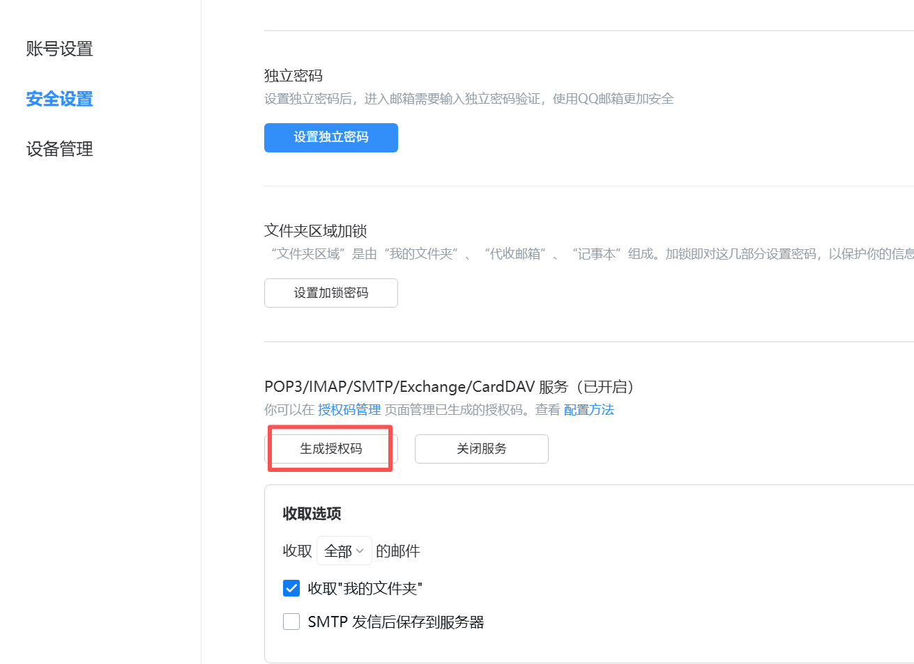
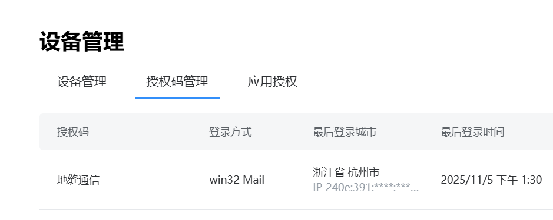
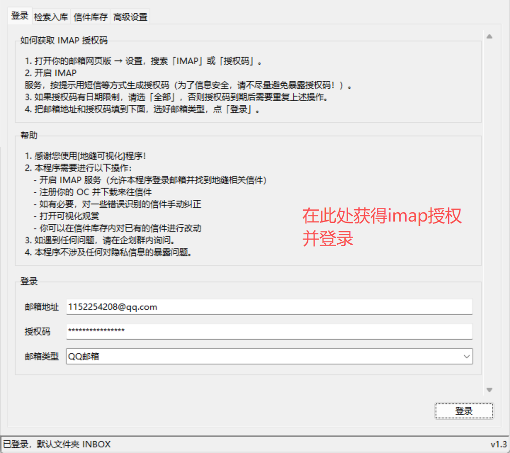
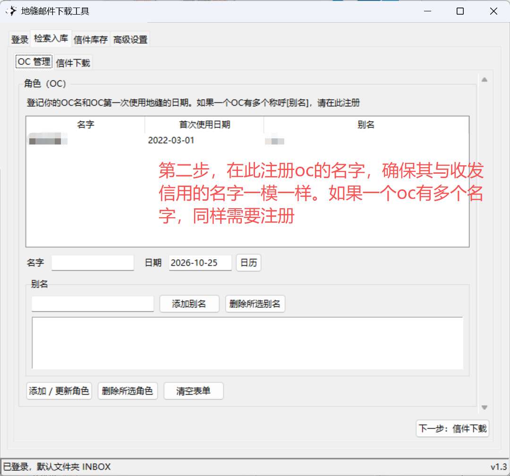
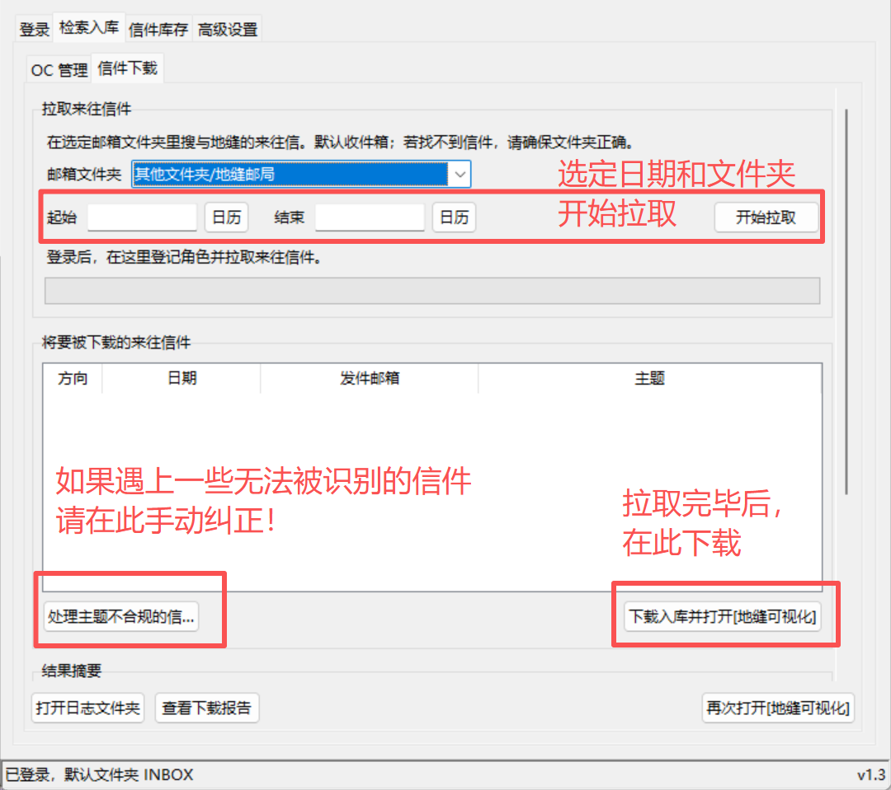
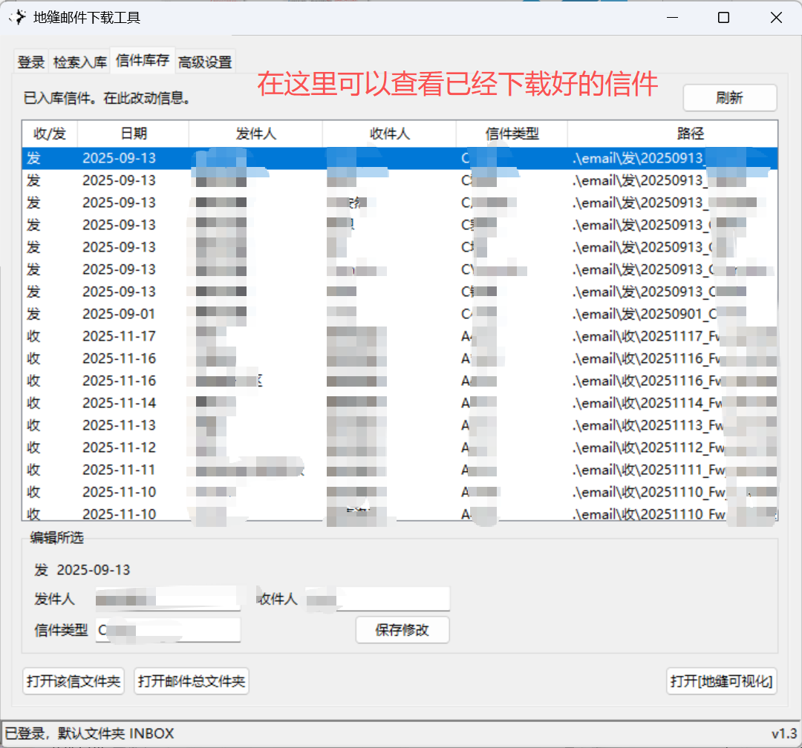

1. 通过对应邮箱的设置选项获得IMAP授权码
   1. 
   2. 
   3. 如果有日期限制，请确保日期选择为全部而不是30天
2. 打开exe程序，按照如下步骤操作
   1. 
   2. 
   3. 
   4. 
3. 注意事项
   1. 在[信件下载]可能会弹出一些被过滤掉的邮件
   3. 一般来说是格式错误导致，当然如果出现大范围的格式错误，可以反馈！
4. 下载后，确保email邮箱内的邮件下载成功，打开html文件
5. 玩的开心！